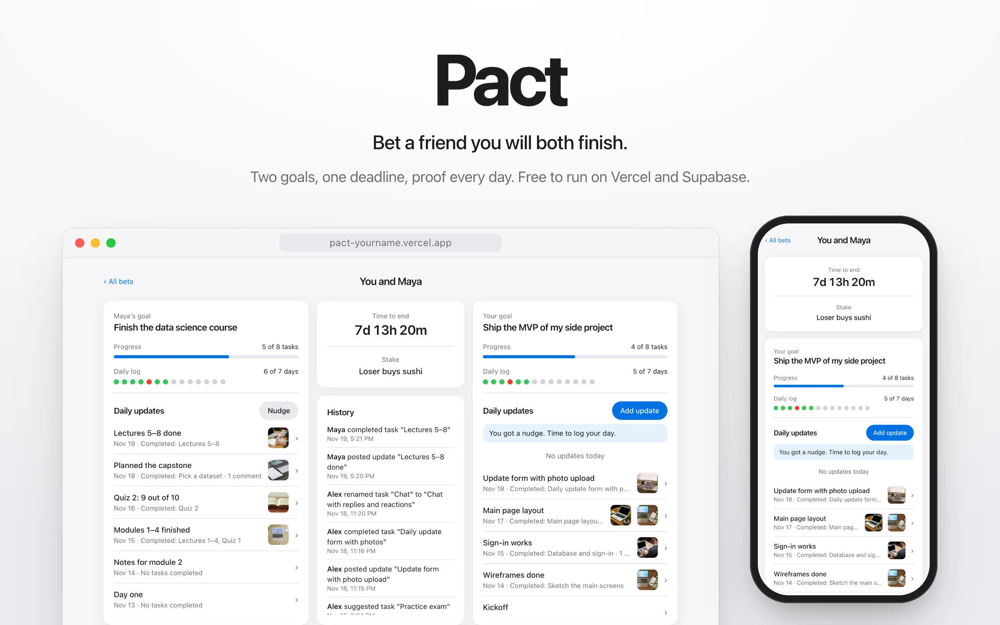

# Pact

Bet a friend that you will both finish your goals.

You each set your own goal, break it into tasks, and post proof of your work every day. You can see each other's progress, comment, chat and nudge. When time runs out, whoever has not finished every task owes the stake.

It is free to run and easy to host yourself: a static site on Vercel and a free Supabase project. There is no server code.

[](https://vercel.com/new/clone?repository-url=https%3A%2F%2Fgithub.com%2Fkharesiddhant%2Fpact&project-name=pact&repository-name=pact&env=VITE_SUPABASE_URL,VITE_SUPABASE_PUBLISHABLE_KEY&envDescription=Your%20Supabase%20project%20URL%20and%20publishable%20key.%20Set%20up%20Supabase%20first%3A%20see%20the%20README.&envLink=https%3A%2F%2Fgithub.com%2Fkharesiddhant%2Fpact%23set-up-your-own-copy)

Set up Supabase first ([step 1 below](#1-create-the-database-on-supabase)), because the Deploy button asks for two values from it.

## What you get

### Two goals, side by side

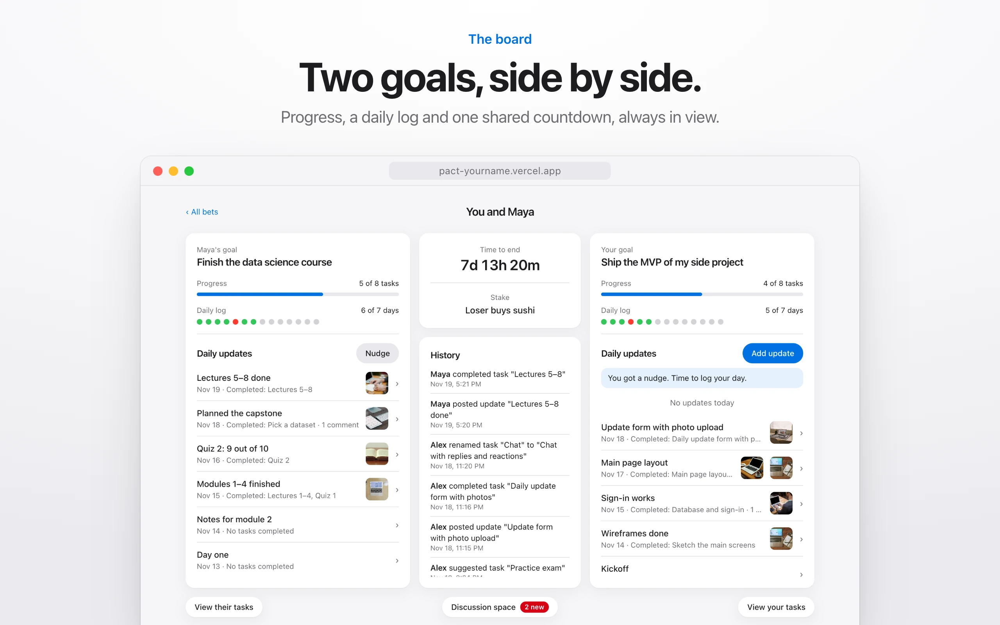

Your goal is on the right and your friend's is on the left. Each side shows progress (tasks done out of total) and a dot for every day of the bet: green for a day with an update, red for a missed day. The countdown, the stake and the history sit in the middle.

### Agree first, then commit

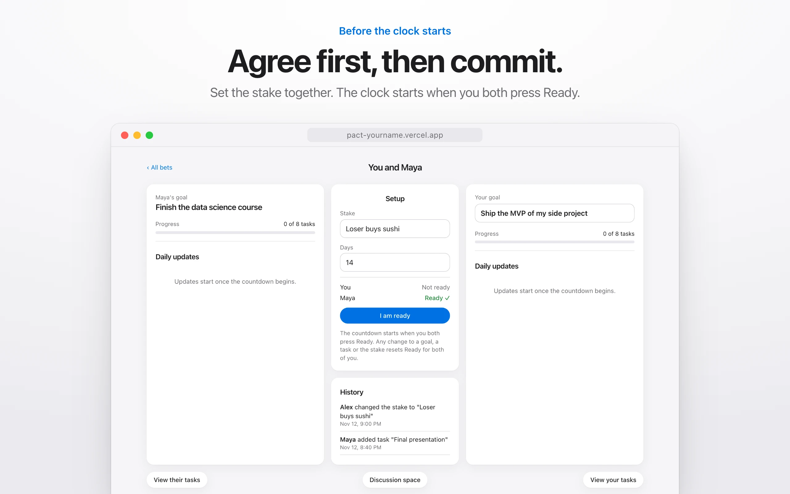

Start a bet, send your friend the invite link, and agree on the stake and the number of days. You each write your goal and your tasks. The countdown starts only when you both press **I am ready**, and any change to the plan resets that for both of you.

### Milestones and tasks

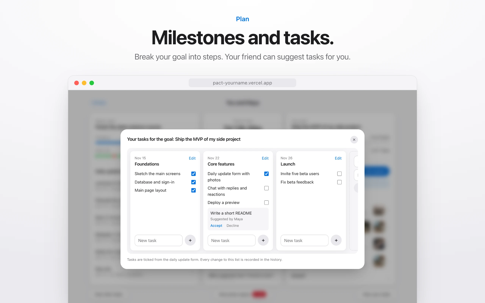

Break your goal into milestones with dates, and add tasks under each one. Your friend can suggest tasks for you, and you choose whether to accept them.

### Log your day

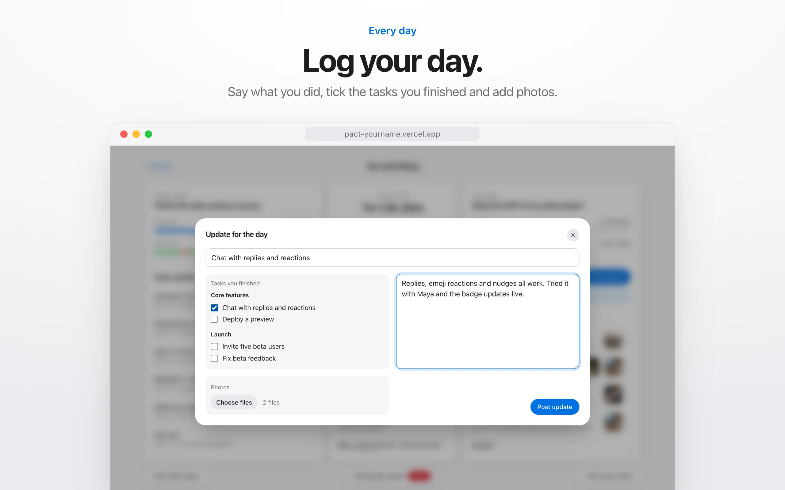

Post an update for the day: what you did, which tasks you finished, and photos. This is the only way to tick a task, so every finished task has proof behind it.

### Proof you can open

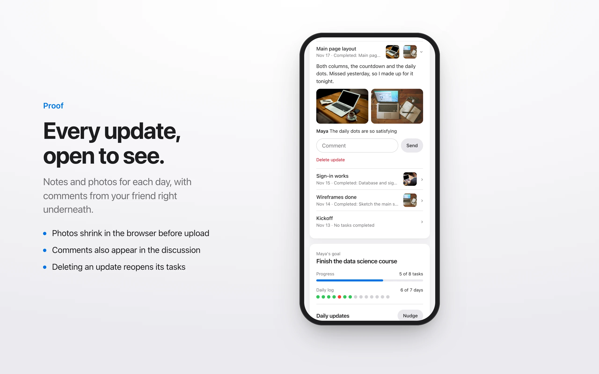

Open any update to see the notes, the photos and your friend's comments. Once an update is posted, its photos cannot be swapped or deleted. Before upload, the browser shrinks each photo to 1600 pixels on its longest side and saves it as WebP (JPEG on Safari), usually under 200 KB, and strips its location data. The storage bucket refuses anything over 1 MB, so the free storage lasts.

### Cheer, nudge, reply

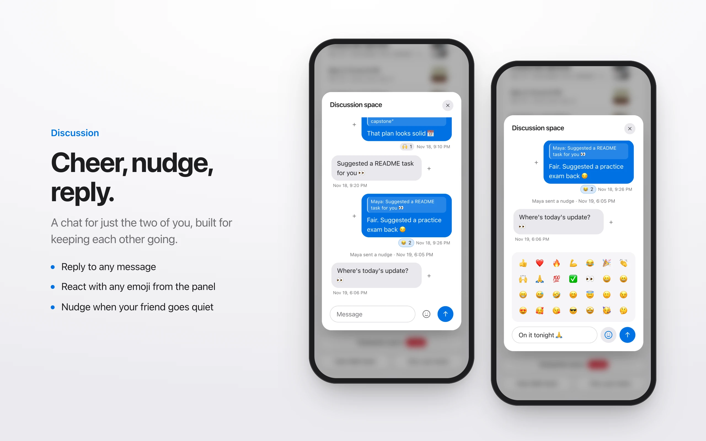

A chat for just the two of you. Reply to any message and react with emoji. When your friend goes quiet, press **Nudge** on their side of the main page.

The bell at the top right lists your friend's new updates, messages and nudges. While the page is open, new activity also plays a soft chime (turn it off in the bell's panel) and shows a count in the browser tab's title.

### Nothing changes quietly

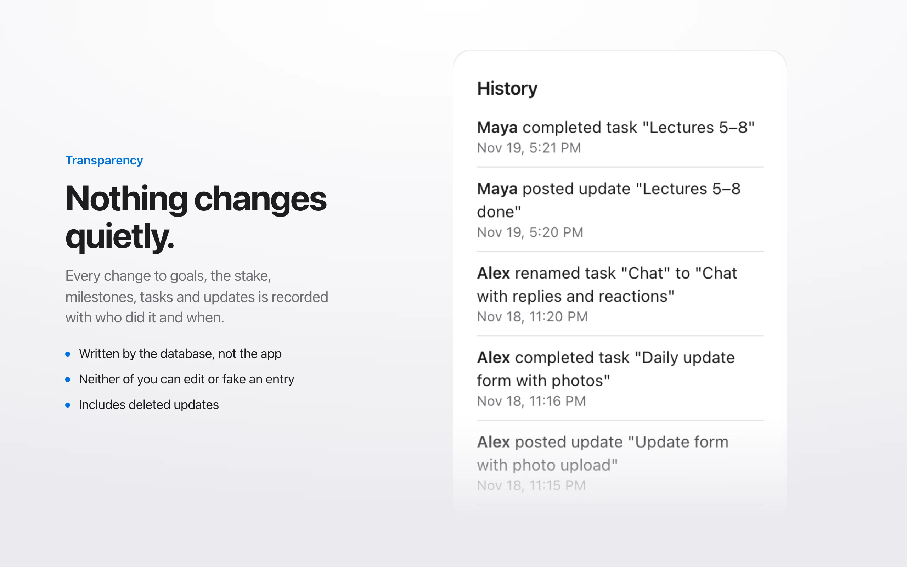

Once the countdown starts, your goal and the stake are locked. You can still adjust your milestones and tasks, but every change is recorded with who made it and when, and so is every update posted or deleted. The database writes these entries itself, so neither of you can edit or fake them from the app.

### Someone buys sushi

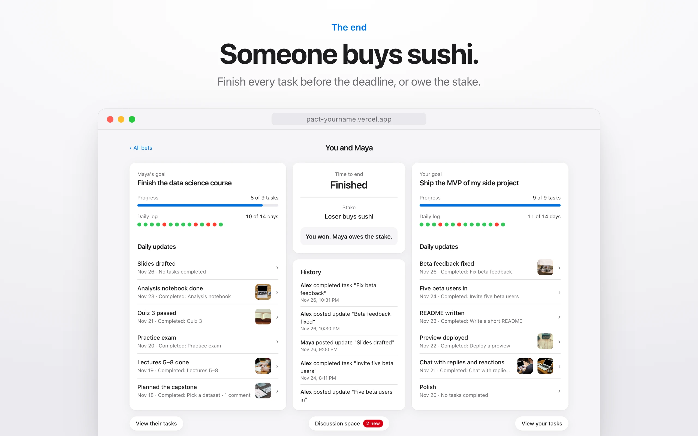

When the countdown ends, the plans freeze: nobody can add, change or delete tasks, milestones or updates any more. Everyone who ticked every task wins. Everyone else owes the stake.

### On your phone too

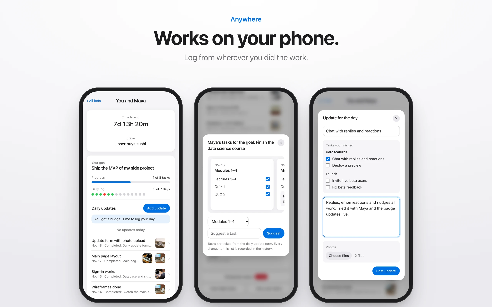

## How it works

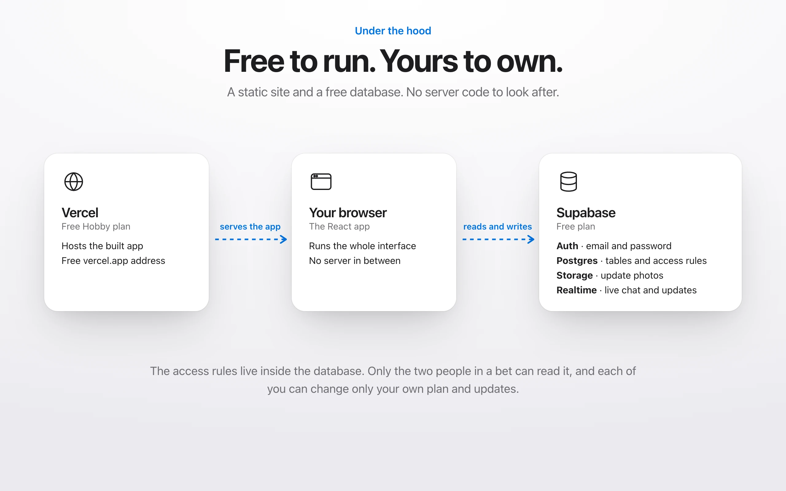

The app is a React site that talks to Supabase directly from the browser. Supabase handles sign-in (email and password), the database, photo storage, and live updates.

The publishable key in the app is meant to be public. What protects your data are the access rules (row level security) in [`schema.sql`](schema.sql): only the two people in a bet can read it, each of you can change only your own plan and updates, and your friend can only suggest tasks, not add or remove them.

These rules bind everyone who uses the app. Whoever owns the Supabase project can still read and change everything from the Supabase dashboard. So your friend has to trust the person hosting, or you can host it on an account that neither of you plays from.

## Set up your own copy

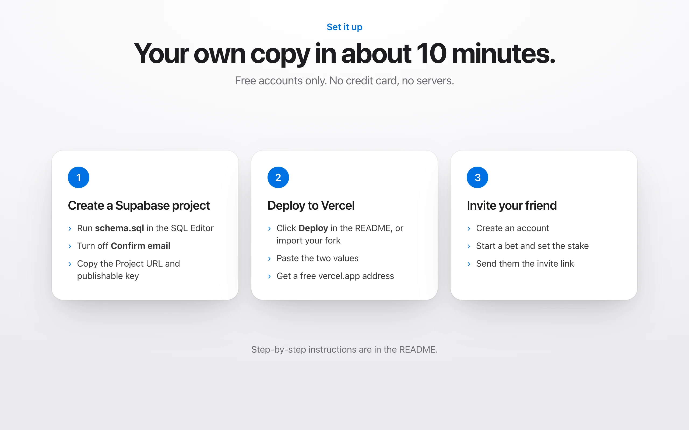

You need free accounts on [GitHub](https://github.com), [Supabase](https://supabase.com) and [Vercel](https://vercel.com). It takes about 10 minutes.

### 1. Create the database on Supabase

1. In Supabase, create a **New project**. If Supabase asks you to create an organization first, choose the Free plan. Pick any project name, set a database password (this app does not need it), and choose the region closest to you. Leave the other options as they are; in particular, keep the Data API on. The Free plan allows 2 active projects.
2. Open [`schema.sql`](schema.sql) on GitHub and click the **Copy raw file** button. In Supabase, open **SQL Editor** in the left sidebar, start a new query, paste, and click **Run**. You should see "Success. No rows returned". This creates the tables, the access rules, the photo bucket and the live-update setup. Run it once, on a new project.
3. Go to **Authentication > Sign In / Providers > Email**, turn off **Confirm email**, and save. Supabase's built-in email service sends only a couple of emails per hour, and only to members of your Supabase organization, so with this on, your friend's sign-up would get stuck.
4. Click **Connect** at the top of the dashboard and copy two values:
   - the **Project URL**, which looks like `https://abcd1234.supabase.co` (not the long `postgresql://` connection string)
   - the **publishable key**, which starts with `sb_publishable_`. You can also find it under **Settings > API Keys**. Never use the secret key.

### 2. Put the app online with Vercel

**Option A: the Deploy button (quickest).** Click **Deploy with Vercel** at the top of this page. Vercel copies this repository into your GitHub account, asks for the two values from step 1, and deploys.

**Option B: fork and import (easier to update later).**

1. Click **Fork** at the top of this page on GitHub.
2. Open [vercel.com/new](https://vercel.com/new) (or click **Create New > Project** in the Vercel dashboard) and import your fork. If it is not in the list, click **Adjust GitHub App Permissions** (or **Configure GitHub App** if the list is empty) and give Vercel access to it.
3. Leave the build settings as they are. Vercel detects Vite and builds into `dist`.
4. Open **Environment Variables** and add both:

   | Name | Value |
   | --- | --- |
   | `VITE_SUPABASE_URL` | Your Project URL, like `https://abcd1234.supabase.co` |
   | `VITE_SUPABASE_PUBLISHABLE_KEY` | Your publishable key, `sb_publishable_...` |

5. Click **Deploy**. After a minute you get a free address like `pact-yourname.vercel.app`.

These values are built into the app when Vercel builds it. If you change them later, open **Deployments**, click the **...** menu next to the latest deployment, and choose **Redeploy**.

### 3. Start your first bet

1. Open your new address and create an account.
2. Under **Start a new bet**, write your goal, the stake and the number of days, then click **Create and invite a friend**.
3. Click **Copy invite link** and send it to your friend. They create an account from the link, join the bet, and type their own goal.
4. You each click **View your tasks** to add milestones and tasks. When you are both happy, you both press **I am ready**, and the countdown starts.

## Run it on your computer

You need [Node.js](https://nodejs.org) 22.12 or newer, [Git](https://git-scm.com), and a Supabase project from step 1.

1. Get the code. Use your fork's address if you have one.

   ```sh
   git clone https://github.com/kharesiddhant/pact.git
   cd pact
   npm install
   ```

2. Copy `.env.example` to a new file called `.env.local` (on macOS or Linux: `cp .env.example .env.local`), and put your Project URL and publishable key in it.
3. Start the app, then open the address it prints (usually http://localhost:5173):

   ```sh
   npm run dev
   ```

Two more commands:

```sh
npm test        # checks the database rules in schema.sql
npm run build   # type-checks and builds the site into dist/
```

`npm test` runs `schema.sql` in an in-memory Postgres and checks the rules that keep a bet honest: outsiders see nothing, a friend can suggest but not edit, nobody can start the countdown alone, nobody can fake or hide a history entry, photos cannot be swapped, and nothing can be changed after the end.

## Updating

1. **Database first.** The [`migrations/`](migrations/) folder holds numbered upgrade files. Paste each one into the SQL Editor and run it, in number order. A file your database already has changes nothing, so running all of them is always safe.
2. **Then the app.**
   - **If you forked:** on your fork's GitHub page, click **Sync fork**, then **Update branch**. Vercel redeploys on its own.
   - **If you used the Deploy button:** your copy is not linked to this repository. Copy over the files you want, or fork instead.

## Troubleshooting

| What you see | What to do |
| --- | --- |
| "Missing VITE_SUPABASE_URL or VITE_SUPABASE_PUBLISHABLE_KEY" | On Vercel: add both environment variables, then Redeploy. On your computer: fill in both values in `.env.local`, then restart `npm run dev`. |
| Sign-up says to check your email | Turn off **Confirm email** (step 1.3). For accounts created before that, open **Authentication > Users** in Supabase and either confirm the user or delete them and sign up again. |
| "permission denied for table ..." | `schema.sql` did not run fully. Run it on a new, empty Supabase project. |
| Nothing loads after you sign in | Check that the Data API is on: **Integrations > Data API** in Supabase. |
| The app stopped loading data after a quiet week | Free Supabase projects pause after about a week without activity. Open the project in Supabase and click **Resume project**. Do it soon: a paused free project can only be restored for a limited time. |
| Your repository is missing from Vercel's import list | Click **Adjust GitHub App Permissions** (or **Configure GitHub App**) on that page and give Vercel access to it. |

## Limits

- A bet is between two people.
- There are no push or email notifications. The bell, the chime and the tab title work only while the app is open in a browser tab.
- A "day" is the calendar day where the person posting the update is. To allow for time zones, an update can be dated one day before or after today's date in UTC, so the daily dots are a guide. The history shows when things really happened.
- Free plans: Supabase gives 2 active projects, a 500 MB database and 1 GB of photo storage (photos are usually under 200 KB each after shrinking, so about 5,000 or more). Vercel's Hobby plan is for personal, non-commercial use.

## Project structure

| Path | What it holds |
| --- | --- |
| [`schema.sql`](schema.sql) | Tables, access rules, history triggers, photo bucket |
| [`migrations/`](migrations/) | Numbered upgrades for databases created with an older `schema.sql` |
| [`src/App.tsx`](src/App.tsx) | Sign-in gate and page routing |
| [`src/Home.tsx`](src/Home.tsx) | Your bets, and the form to start one |
| [`src/Challenge.tsx`](src/Challenge.tsx) | The main page: both columns, countdown, setup, history |
| [`src/Tasks.tsx`](src/Tasks.tsx) | Milestones and tasks, editing and suggestions |
| [`src/UpdateForm.tsx`](src/UpdateForm.tsx) | The daily update form and photo upload |
| [`src/Chat.tsx`](src/Chat.tsx) | Discussion space |
| [`test/schema.test.mjs`](test/schema.test.mjs) | Tests for the database rules |
| [`docs/images/`](docs/images/) | The screenshots in this README |

## Credits

The people and data in the screenshots are made up. The photos come from [Unsplash](https://unsplash.com) (via [Lorem Picsum](https://picsum.photos)) under the [Unsplash License](https://unsplash.com/license). Photographers: Alejandro Escamilla, Galymzhan Abdugalimov, Aleksi Tappura, William Iven and Dustin Lee.

## License

[MIT](LICENSE)
